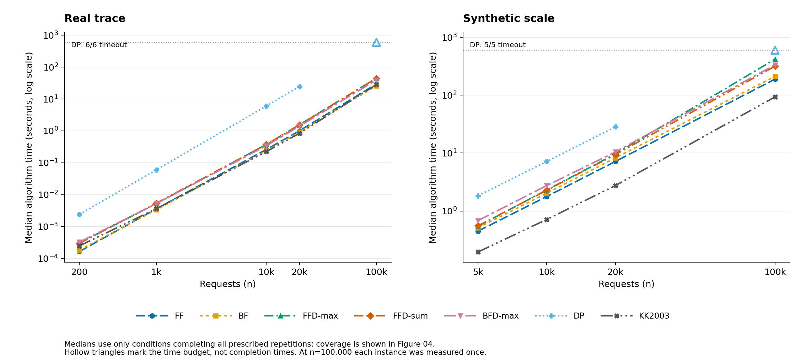

# Azure 虚拟机 CPU / 内存二维装箱

把一批虚拟机请求放入尽量少的同规格主机，同时满足每台主机的 CPU 与内存容量限制。项目使用 Python、SQLite 和 Gurobi，完成数据提取、七种确定性算法实现、两条 MIP 求解路径，以及结果检查、保存与可视化。

当前实验覆盖 **280 个实例、2190 行方法结果**，单实例最多 **100000 条请求**。真实组 MIP 证明了 **21/30** 个实例最优，合成质量组证明了 **179/200** 个实例最优。

## 主要结果

| 观察 | 实验依据 |
|---|---|
| FFD-max 适合本批合成质量分布 | 达到 MIP 最终方案效果 191/200。对 FFD-sum 为 145 胜、55 平、0 负 |
| 排序效果依赖数据结构 | 真实组 FFD-max 对 FFD-sum 为 1 胜、23 平、6 负 |
| KK2003 与 FFD-max 的合成质量对照 | 合成质量组的平均 A/OPT(U) 分别为 1.209118* 和 1.000494* |
| 继续优化增加了最优证明 | 60 秒记录到结束，真实组从 19 例增至 21 例，合成质量组从 174 例增至 179 例 |

胜、平、负均比较同一实例的主机数，越少越好。`*` 表示均值纳入尚未证优的 MIP 方案参照。在合成质量组已证优的 179 个实例上，FFD-max 命中最优 172 个。

十万条合成实例的五个条件中，KK2003 的纯算法耗时中位数为 93.47 秒，FFD-max 为 419.54 秒。对应平均 A/L 为 1.33522、1.05841，体现速度与装箱质量的取舍。

完整结果：[真实数据报告](results/formal_real_600_1200/analysis.md)、[合成质量报告](results/formal_synthetic_quality_600_1200/analysis.md)、[合成规模报告](results/formal_synthetic_scale_600_1200/analysis.md)。



[六组图表说明](results/figures/FIGURE_GUIDE.md)同时给出质量、耗时、完成覆盖率及 MIP 证优进度；逐点数据保存在 `results/figures/plot_data.json`。

## 问题与建模范围

请求 i 的资源需求为 `(cpu_i, memory_i)`，每台主机的两维容量归一化为 `(1, 1)`。每条请求恰好分配一次，每台主机两维总需求均不超过 1，目标是最小化使用的主机数。

真实数据固定 `machineId=12`，取兼容请求的资源份额，再模拟多台这种规格的主机。

模型采用静态、同构的批次离线放置，批次内的所有请求同时计入主机容量。

## 算法与 MIP

| 方法 | 本项目的具体规则 |
|---|---|
| FF | 按输入顺序放入第一台两维均可行的主机 |
| BF | 在可行主机中最小化放入后的剩余 CPU 与内存之和 |
| FFD-max | 按 max(CPU, Memory) 降序，再执行 FF |
| FFD-sum | 按 CPU+Memory 降序，再执行 FF |
| BFD-max | 按 max(CPU, Memory) 降序，再执行 BF |
| DP | 等权 bin-centric：为当前主机选择可行且“需求·剩余容量”最大的请求 |
| KK2003 | Kellerer–Kotov 的分类、成组填充与调整算法 |

请求评分同分按 ID，主机同分按创建顺序处理。FFD 两版本只改变排序分数，便于配对比较。KK2003 按论文流程实现并检查分组。 [理论近似比及来源](PROJECT_PLAN.md#2-算法与理论参照)

MIP 初值取七种算法首遍有效方案中台数最少的一份。正式求解按数据结构分为两条路径：

- **真实数据：类型聚合模型。** 相同 `(CPU, Memory)` 的请求合为类型 t，用整数 `q[t,j]` 表示主机 j 接收该类的数量，用二元 `y[j]` 表示主机启用，最小化 `sum(y)`。约束覆盖各类型数量、两维容量和主机顺序，提供 MIP start。求解后恢复原请求 ID。
- **合成质量数据：不相容团锚定的固定 K 模型。** 团中的请求两两不能同机，将它们固定到不同主机，扣除容量，仅对可能的请求—主机组合创建二元变量。当前上界为 U 时测试 K=U−1；找到方案则改善 U，证明不可行则提高 L，未知则保留现有界。各次优化共享预算。

类型聚合减少重复请求的指派对称性。团锚定与固定 K 减少主机标签对称性和变量。 [完整约束](PROJECT_PLAN.md#4-mip模型)

`solution_checker.py` 独立检查请求身份、无重无漏及逐台两维容量。达到有效下界、优化模型证优或证明 U−1 台不可行，才记为已证最优。

## 数据与实验设计

| 实验组 | 规模 n | 条件 | 实例数 | 方法结果行数 |
|---|---|---|---:|---:|
| 真实 | 200、1000、10000、20000、100000 | 6 个时间窗口 | 30 | 240 |
| 合成质量 | 100、200、500、1000 | 5 个 alpha × 10 个 seed | 200 | 1600 |
| 合成规模 | 5000、10000、20000 | 5 个 alpha × 3 个 seed | 45 | 315 |
| 合成压力（归入规模组） | 100000 | 5 个 alpha × 1 个 seed | 5 | 35 |

### 真实请求轨迹

本项目使用微软于 2020 年公开的 [Azure Trace for Packing 2020](https://github.com/Azure/AzurePublicDataset/blob/master/AzureTracesForPacking2020.md)。它来自 Azure Compute 单个可用区的匿名历史记录，采集窗口为连续 **14 天**，用途是评估虚拟机装箱算法。公开资料以采集开始为零点，按相对天数记录时刻，未列出采集的公历起止日期。原始 SQLite 文件 `packing_trace_zone_a_v1.sqlite` 有两张表：`vm` 记录请求，`vmType` 记录各虚拟机类型在不同硬件规格上的资源需求。

#### `vm`：虚拟机请求

共 **5,559,800 条**，包括采集开始时已在运行的虚拟机。每行记录一条请求。

| 字段 | 含义 |
|---|---|
| `vmId` | 匿名请求编号，在当前 SQLite 文件内唯一。 |
| `tenantId` | 匿名租户编号，用于识别同一租户发出的多条请求。 |
| `vmTypeId` | 请求的虚拟机类型编号。 |
| `priority` | 优先级，`0` 为高优先级，`1` 为低优先级。低优先级虚拟机可能被提前驱逐。 |
| `starttime` | 请求创建时刻。负值表示采集开始前已创建，`2.5` 表示采集开始后两天半。 |
| `endtime` | 虚拟机实际离开系统的时刻，可晚于第 14 天；`NULL` 表示没有可用的离开时刻。 |

#### `vmType`：虚拟机类型与硬件资源

共 **4,619 条类型与硬件组合记录**，覆盖 **488 种虚拟机类型**和 **35 种硬件规格**。一条记录回答的是：某类虚拟机能放在哪种硬件上，以及在该规格的一台主机上要预留多少资源。以下五种资源都按单台主机总容量的比例记录，例如 `core=0.05` 代表预留 5% 的 CPU 容量。

| 字段 | 含义 |
|---|---|
| `id` | 这条规格记录的唯一行编号。 |
| `vmTypeId` | 虚拟机类型编号，同一类型可以出现在多种硬件规格上。 |
| `machineId` | 主机硬件规格编号。本项目按此字段选规格，装箱时另行编号每台主机。 |
| `core` | CPU 容量份额。 |
| `memory` | 内存容量份额。 |
| `hdd` | 机械硬盘容量份额。 |
| `ssd` | 固态硬盘容量份额。 |
| `nic` | 网络带宽份额。 |

#### 从原始轨迹到实验输入

先在 `vm` 查到请求的 `vmTypeId`，再从 `vmType` 中选择该类型在 `machineId=12` 上的记录。以请求 `3777315` 为例：它在采集开始满 1 天时创建，申请 65 型虚拟机。同是 65 型，在规格 1 上需要约 **2.08% CPU、1.24% 内存**，在规格 12 上需要 **5% CPU、1.37% 内存**。因此固定硬件规格后，才能确定本实验使用的两维需求。

实例 JSON 的 `requests` 按 `[vmId, vmTypeId, starttime, core, memory]` 保存每条请求，前 3 项来自 `vm`，后 2 项来自 `vmType`。上面的请求是 `real_m12_w1_2_n200` 的首条，保存为 `[3777315, 65, 1.0, 0.05, 0.013671875]`。

提取时保留两维资源在 `(0,1]` 的请求，按 `starttime, vmId` 升序取窗口前 n 条。窗口为 `[1,2)`、`[2,3)`、`[3,4)`、`[6,7)`、`[9,10)`、`[12,13)` 天。同一窗口中，较大的实例包含较小实例的所有请求。JSON 另存硬件规格、时间窗口和请求数。实验把选中的请求视为同时占用容量的一批，比较各算法所需的主机数。

### 合成数据与运行设置

合成数据每条请求独立采样两个 `(0,1)` 数，在该对内排序为 `l<h`。随机选取恰好 alpha×n 条设为 `(l,h)`，其余为 `(h,l)`。alpha 取 `{0.1,0.2,0.3,0.4,0.5}`，表示内存偏重比例。同一 `(n,seed)` 的不同 alpha 共用基础数对、方向优先序和输入顺序，支持配对比较。

启发式每次调用预算 **600 秒**；除 n=100000 测一次外，每实例测三次。MIP 每实例累计优化预算 **1200 秒**，保留同次任务的 60 秒记录。真实 MIP 使用 1 线程，合成 MIP 使用 2 线程；Seed=0。启发式私有内存采样限额 2048 MiB，Gurobi SoftMemLimit=2.0 GB。运行平台与版本详见各组 `metadata.json`。

## 指标与计时

记 A 为算法有效台数，L 为有效下界，U 为 MIP 最终最好有效方案台数，满足 `L ≤ OPT ≤ U`。参照 R 在已证优时取 OPT，否则取 U。

| 指标 | 含义 |
|---|---|
| 达到 MIP 效果 | `A ≤ U` 的实例数 / 全部条件数 |
| 平均 A/OPT(U) | 逐实例计算 A/R 后取平均；含未证优参照时标 `*` |
| 平均或最大参照差距 | `(A-R)/R`。使用 U 时，逐实例的参照差距是实际最优差距的下界 |
| A/L、(A-L)/L | 相对有效下界的比值及差距，分别是对应最优指标的上界 |
| 已证优数量、(U-L)/L | 评价 MIP 的证明进度与当前界的距离 |
| 有效方案覆盖、完整计时覆盖 | 区分返回可用方案和完成全部规定计时重复 |

质量先逐实例算比值再平均。计时先取每实例重复中位数，再取同规模窗口或种子间中位数。启发式时间只测算法函数。MILP 行时间包括七方法首遍外部尝试与 MIP 封装全程。`solve_seconds` 仅计 Gurobi 优化。

本批正式记录包含以下未完成情况：

- DP 在真实组六个、合成规模组五个十万条条件中均触及 600 秒预算，没有完整方案。
- 合成规模组 `synthetic_v2_a40_s0_n10000` 的 BF 第三次计时遇到临时控制文件读取 `PermissionError`；前两次成功，5691 台首遍方案有效。质量保留，完整计时为 2/3，中位耗时留空。
- 真实组 9 个 MIP 未证优，其中 4 个为 TIME_LIMIT，5 个为 MEM_LIMIT。合成质量组 21 个未证优，均为 TIME_LIMIT。真实十万条 MIP 为 1/6 证优。

超时和错误保留对应状态，缺失指标留空。

## 运行与复现

当前环境为 Windows PowerShell、Python 3.12.10、gurobipy 13.0.3、Matplotlib 3.10.7。批量监督器使用 Windows 私有内存采样。MIP 需要有效 Gurobi 许可。

### 1. 创建环境与安装依赖

在项目根目录打开 PowerShell，使用 Python 3.12 创建虚拟环境。

```powershell
py -3.12 -m venv .venv
& ".\.venv\Scripts\python.exe" -m pip install -r requirements.txt
```

如果本机使用 `python` 启动 Python 3.12，可用 `python -m venv .venv` 创建。已有 `.venv` 时可直接安装依赖。`requirements.txt` 固定直接依赖，各组元数据记录实际运行环境。

### 2. 直接阅读或重生成现有报告

以下命令读取现有正式结果并生成报告和图表。

```powershell
& ".\.venv\Scripts\python.exe" ".\analyze_real.py"
& ".\.venv\Scripts\python.exe" ".\analyze_synthetic.py"
& ".\.venv\Scripts\python.exe" ".\plot_results.py"
```

三个 `analysis.md` 保存在对应正式目录；六组 PNG/PDF、图注与逐点 JSON 保存在 `results/figures/`。

### 3. 从原始数据构建输入（按需）

从下方官方数据页面下载并解压 SQLite，将文件放到项目目录下的 `data/raw/packing_trace_zone_a_v1.sqlite`。`build_instance.py` 会从这里读取数据库。

```powershell
& ".\.venv\Scripts\python.exe" ".\build_instance.py"
& ".\.venv\Scripts\python.exe" ".\build_synthetic.py"
```

分别生成 30 份真实实例和 250 份合成实例。已有固定输入可直接使用；生成命令会覆盖同名输入文件。

### 4. 从头重跑实验（按需）

先完成 Gurobi 许可配置。这三条命令会执行整组实验，使用与正式组不同的输出目录：

```powershell
& ".\.venv\Scripts\python.exe" ".\run_batch.py" --suite real --output-dir ".\results\reproduce_real_600_1200" --heuristic-seconds 600 --mip-seconds 1200 --snapshot-seconds 60
& ".\.venv\Scripts\python.exe" ".\run_batch.py" --suite synthetic-quality --output-dir ".\results\reproduce_quality_600_1200" --heuristic-seconds 600 --mip-seconds 1200 --snapshot-seconds 60
& ".\.venv\Scripts\python.exe" ".\run_batch.py" --suite synthetic-scale --output-dir ".\results\reproduce_scale_600_1200" --heuristic-seconds 600 --mip-seconds 1200 --snapshot-seconds 60
```

规模组执行七种启发式。每完成一个实例就原子保存检查点。源码、输入、环境及配置一致时，可用同一命令从已保存的实例续跑。源码 SHA256、输入 SHA256 或配置变化后，选择新目录。中断时尚未保存的实例需要重跑。

报告与绘图默认读取三个 `formal_*_600_1200` 目录。实验元数据记录运行时的源码指纹，绘图数据记录生成时的分析与绘图源码指纹。

## 文件导航

| 文件或目录 | 用途 |
|---|---|
| `packing_algorithms.py`、`kellerer_kotov.py` | 七种算法 |
| `milp_solver.py`、`mip_progress.py` | 模型、界、解恢复及进度观测 |
| `solution_checker.py`、`result_metrics.py` | 独立放置检查及统一质量指标 |
| `build_instance.py`、`build_synthetic.py`、`instance_io.py` | 输入构建与读写 |
| `benchmark_heuristics.py`、`run_batch.py` | 预算监督、重复测量、正式矩阵与续跑 |
| `analyze_real.py`、`analyze_synthetic.py`、`plot_results.py` | 派生报告与图表 |
| `data/instances/` | 固定输入 JSON |
| `results/formal_*_600_1200/` | 汇总 CSV、环境元数据、逐实例状态与 ID 分组 |
| `try/` | 教学和小例子检查；使用方法见其 README |
| [PROJECT_PLAN.md](PROJECT_PLAN.md) | 唯一项目方案、完整模型与理论参照 |
| [DATABASE_GUIDE.md](DATABASE_GUIDE.md) | 环境、Python、SQL、文件读写与 Gurobi 用法回顾 |
| [INTERVIEW_GUIDE.md](INTERVIEW_GUIDE.md) | 简历表述、项目介绍与面试追问 |

版本库保留固定实验输入和正式结果。原始 SQLite 由读者按需下载，虚拟环境按上述命令创建。

## 数据来源与算法参考

真实数据来自 Microsoft Azure **Azure Trace for Packing 2020**。官方说明数据采用 CC-BY Attribution License，并要求使用时引用配套论文：Ori Hadary et al., *Protean: VM Allocation Service at Scale*, OSDI 2020。本项目选取其中一个 zone 的请求与资源规格，构建上述静态二维子问题。[官方数据说明、许可与下载入口](https://github.com/Azure/AzurePublicDataset/blob/master/AzureTracesForPacking2020.md)

- Panigrahy et al., *Heuristics for Vector Bin Packing*, 2011：[论文](https://www.microsoft.com/en-us/research/wp-content/uploads/2011/01/VBPackingESA11.pdf)。DP 使用本文框架中的指定等权配置。
- Kellerer and Kotov, *An approximation algorithm with absolute worst-case performance ratio 2 for two-dimensional vector packing*, Operations Research Letters, 2003：[DOI](https://doi.org/10.1016/S0167-6377(02)00173-6)、[公开全文](https://www.labri.fr/perso/eyraud/pmwiki/uploads/Main/Kellerer2003-VectorPacking2Approx.pdf)。KK2003 为确定性绝对 2 近似理论参照与实现来源。
